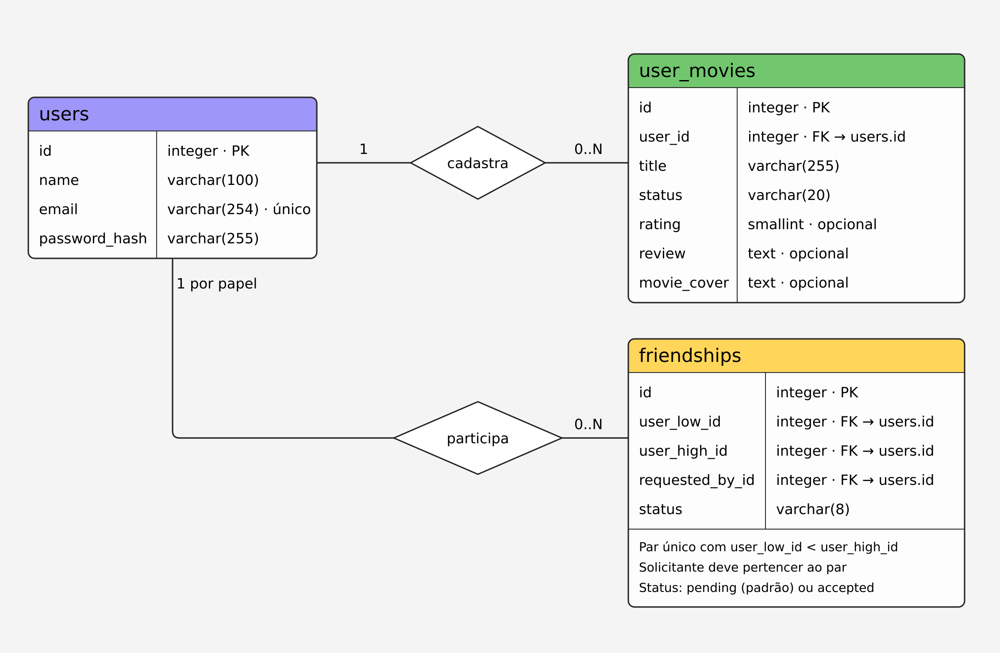

# entregas-c216
## objetivo e tema
O projeto se trata de uma especie de "rede social" para compartilhar opiniões sobre filmes que voce viu com seus amigos e poder cadastrar filmes que voce não viu mas ainda quer ver, podendo tambem ver quais filmes e analises seus amigos viram/fizeram e tambem quais eles quere ver.
## Funcionalidades
- Login e cadastro de usuario
- Adicionar e remover amigos
- Cadastrar, Ver, Editar e Excluir filmes que quer assistir ou ja assistiu
- Notas e opiniões para filmes assistidos
- Visualização de filmes cadastrados pelos amigos tanto `assistido` ou `quero assistir`
## Tecnologias
### Backend
- Python
- FastAPI
- Alembic
- PostgresSQL
- SQLAlchemy
#### Autenticação
- JWT
- Python-jose
- Argon2
#### Testes e CI
- Pytest
- Ruff
- Docker
### Frontend
- JavaScript
- React
- Vite
- Tailwind CSS
#### Testes e CI
- Vitest
- React Testing Library
- Playwright
- Biome
- Docker
### Banco de Dados
O banco de dados usado é o `PostgresSQL` como citado acima, a estrutura do banco esta representada na imagem a seguir:

## Estrutura resumida
### Backend
- `app/api`: rotas; `models` e `schemas`: dados; `services` e `repositories`: regras e acesso ao banco.
- `test`: testes unitários e de integração.
### Frontend
- `src/pages`, `components`, `hooks` e `services`: telas, componentes, estado e comunicação com a API.
- `tests`: testes unitários, de integração e E2E.

Outros comandos úteis: `make help`, `make build`, `make db-up`, `make db-down`, `make db-delete`, `make test`, `make test-backend`, `make test-front`, `make test-e2e`, `make lint-backend`, `make lint-front`, `make format-check-front`, `make check-front` e `make check-all`.
## Pré-requisitos
Para executar o projeto é necessario principalmente ter o `Docker` instaldo na maquina, para executar localmente sem docker é necessario ter o `python 3.14`, `poetry` e `node 24` instalados e instalar as dependencias do projeto rodando `make install`.
## Variáveis de ambiente
### backend
- APP_KEY usada para assinar tokens JWT na autenticação pode ser gerado com `make app-key`
- DATABASE_URL é necessaria para o `backend` poder comunicar com o banco de dados a variavel de exemplo precisa que sejam preenchidos o `user`, `senha` e `nome do banco` configurados no postgres dentro do `docker-compose.yaml`
- CORS_ORIGINS é necessario para que o backend aceite requisições vindas do endereço do frontend eles devem ser indicados com a url completa e separados por `,`
> [!TIP]
> Todas as variaveis do backend estão exemplificadas em  `backend/.env.example` basta copiar e colar o arquivo na mesma pasta e apagar o `.example` do final e preencher com suas variaveis
### Frontend
- VITE_API_URL que é a url usada pelo `VITE` para fazer as requisições a API ela deve ser informada completa como no exemplo em `frontend/.env.example`
## Comandos de execução
Execute os comandos na raiz do projeto:

```bash
make install       # instala as dependências
make build         # (opcional) builda as imagens docker
make up            # inicia os serviços com Docker Compose
make db-upgrade    # aplica as migrations (com o serviço web iniciado)
make down          # para os serviços
```
Uma vez o projeto executado com `make up` como acima basta acessar `http://localhost:5173` se voce não tiver trocado as portas no `docker-compose.yaml`
## Migrações
- **Usuários e filmes:** cria as tabelas `users` e `user_movies`, com status, nota e resenha.
- **Amizades:** cria `friendships` para solicitações e conexões aceitas entre usuários.
- **Capas de filmes:** adiciona a coluna opcional `movie_cover` em `user_movies`.
